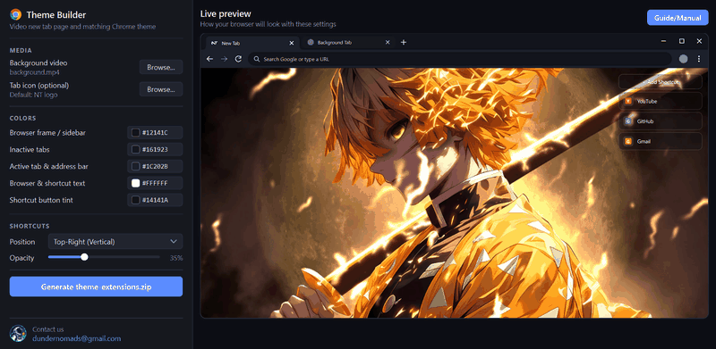
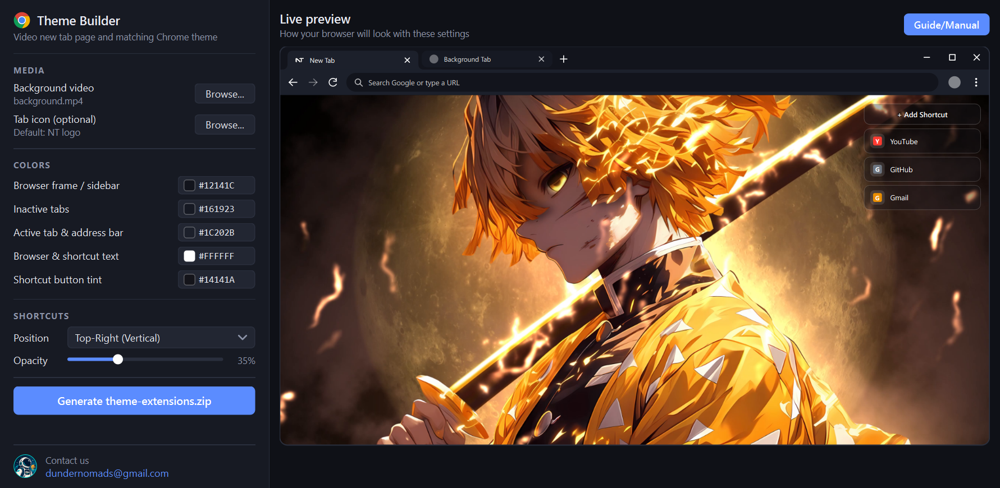
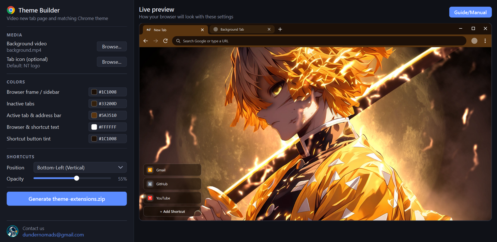
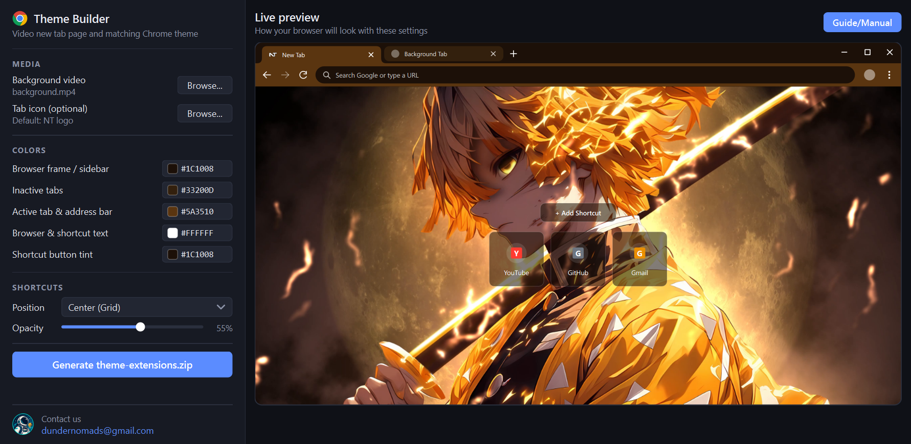
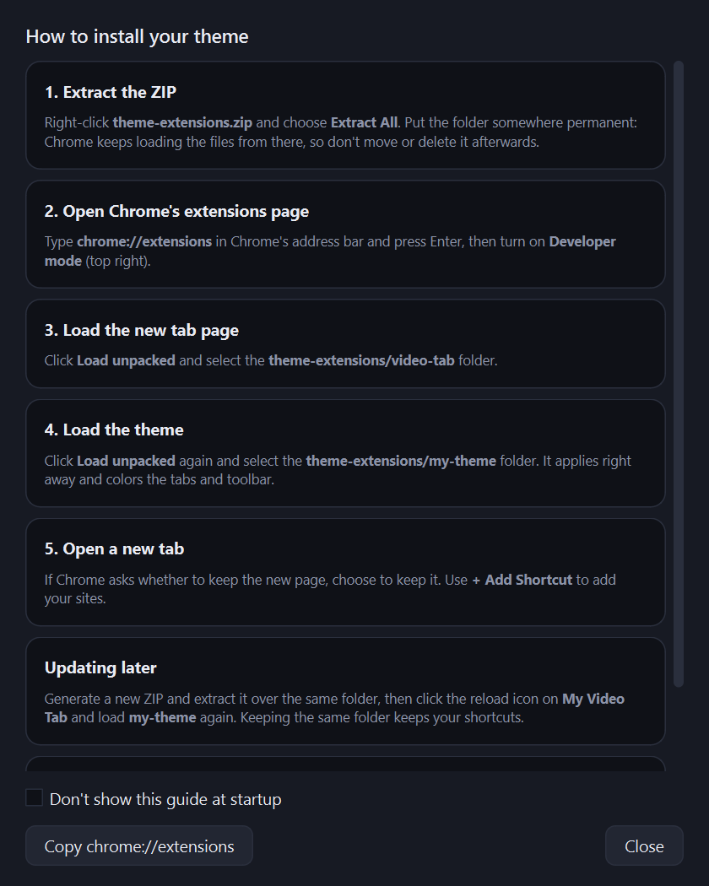

# Chrome Video Tab & Theme Builder

A desktop app that turns any `.mp4` video into your Chrome new tab page, with a matching browser theme. Pick a video and colors, check the live preview, and generate a ZIP that you load into Chrome. No coding needed.



## Features

- **Video new tab page:** your video loops, muted, behind your shortcuts.
- **Matching Chrome theme:** colors for the tab strip, tabs, toolbar, address bar and text.
- **Live preview:** see the video, colors and shortcut layout in a mock browser window before generating.
- **Shortcut layouts:** four corner lists or a centered grid, with adjustable button color and opacity. In the bottom layouts, the list grows upward from the **+ Add Shortcut** button.
- **Custom tab icon:** use your own image, or keep the default NT logo.
- **Built-in guide:** install steps open at startup and after each build.

## Screenshots

| Top-right shortcuts, default colors | Bottom-left shortcuts, custom colors |
|---|---|
|  |  |

| Centered grid | Guide/Manual |
|---|---|
|  |  |

## Windows: run without installing Python

If someone gave you `ChromeThemeBuilder.exe`, you only need that file and Google Chrome.

1. Save `ChromeThemeBuilder.exe` anywhere, for example on your Desktop.
2. Double-click it. The first window can take a few seconds to appear.
3. If Windows shows **Windows protected your PC**, click **More info**, then **Run anyway**. The warning appears because the app is not code-signed. Only run a copy from someone you trust.

Then continue with [How to use](#how-to-use). The rest of this section and **Installation** are for running or building the app from source.

## Requirements

- Python 3.10 or newer (developed on Python 3.11, Windows 11)
- Google Chrome
- The Python packages in [`requirements.txt`](requirements.txt):
  - `PySide6-Essentials` for the app window
  - `opencv-python` to play the video in the live preview (the app still builds ZIPs without it)

## Installation

1. Download the project:

   ```bash
   git clone https://github.com/patrickian/chrome-theme-builder.git
   cd chrome-theme-builder
   ```

2. Optional: create a virtual environment, so the packages stay inside this project.

   ```bash
   python -m venv .venv
   ```

   Activate it on Windows (PowerShell):

   ```powershell
   .venv\Scripts\Activate.ps1
   ```

   Or on macOS and Linux:

   ```bash
   source .venv/bin/activate
   ```

3. Install the packages:

   ```bash
   pip install -r requirements.txt
   ```

4. Start the app from the project folder:

   ```bash
   python -m theme_builder
   ```

## How to use

### 1. Build your theme

| Setting | What it does |
|---|---|
| **Background video** | The `.mp4` that plays on the new tab page. Required. |
| **Tab icon** | Optional image for the new tab. The NT logo is used if you pick none. |
| **Browser frame / sidebar** | Tab strip and address bar color |
| **Inactive tabs** | Background tab color |
| **Active tab & address bar** | Active tab and toolbar color (the address field itself uses the frame color) |
| **Browser & shortcut text** | Text in the browser and on the shortcuts |
| **Shortcut button tint** | Shortcut button color |
| **Position** | Where the shortcuts appear on the new tab page |
| **Opacity** | How solid the shortcut buttons are |

Click **Generate theme-extensions.zip** and choose where to save it.

### 2. Install it in Chrome

1. Right-click `theme-extensions.zip` and choose **Extract All**. Keep the extracted folder somewhere permanent, because Chrome loads the files from it.
2. Open `chrome://extensions` and turn on **Developer mode** (top right).
3. Click **Load unpacked** and select the `theme-extensions/video-tab` folder.
4. Click **Load unpacked** again and select the `theme-extensions/my-theme` folder.
5. Open a new tab. If Chrome asks whether to keep the new page, choose to keep it.

> Extract All can create the folder name twice (`theme-extensions/theme-extensions/...`). Select the inner `video-tab` and `my-theme` folders.

The ZIP contains two parts:

| Folder | Changes |
|---|---|
| `video-tab` | The new tab page: video, shortcuts and tab icon |
| `my-theme` | Chrome's own colors. Optional. |

### 3. Add your shortcuts

On the new tab page, click **+ Add Shortcut** and enter a name and address. Hover over a shortcut to edit or remove it. Shortcuts are saved in Chrome's extension storage. Their site icons are loaded from Google's favicon service, so Google receives the domain names of your shortcuts.

### Updating later

Generate a new ZIP and extract it over the same folder. On `chrome://extensions`, click the reload icon on **My Video Tab**, then load `my-theme` again. Keeping the same folder keeps your shortcuts.

### Removing it

Remove **My Video Tab** on the extensions page (this also deletes its shortcuts). To restore Chrome's colors, open **Settings > Appearance** and reset the theme.

## Troubleshooting

| Problem | What to try |
|---|---|
| The browser colors did not change | Load the `my-theme` folder. The new tab extension does not color the browser. |
| An old tab icon still shows | Reload the extension, then restart Chrome. Chrome caches icons. |
| No video in the live preview | Install `opencv-python`: `pip install opencv-python` |
| The startup guide is gone | Click **Guide/Manual** and untick **Don't show this guide at startup**. |

## Build the Windows exe

On Windows, from the project folder:

```bash
pip install -r requirements-build.txt
python scripts/build_exe.py
```

The result is `dist/ChromeThemeBuilder.exe`, a single portable file that includes Python, Qt and OpenCV. Share it as it is; there is nothing to install. The version number comes from `theme_builder/__init__.py`.

If you share the exe publicly, follow the license terms of the bundled libraries, including the LGPL for Qt/PySide6 and the FFmpeg library inside OpenCV.

## Project structure

```text
theme_builder/
├── app.py        main window
├── core/         settings, colors and asset paths
├── media/        video playback and images
├── ui/           sidebar, live preview and guide window
├── builder/      creates the ZIP (web page templates in builder/templates/)
└── assets/       icons and logos
scripts/          builds the Windows exe
```

## Credits and disclaimer

- **Demo artwork:** the background video shown in the demo GIF and screenshots depicts Zenitsu Agatsuma from *Demon Slayer: Kimetsu no Yaiba*, © Koyoharu Gotoge / SHUEISHA, Aniplex, ufotable. The creator of this particular artwork and video is not known to us. All rights belong to their respective owners. It is used only to demonstrate the app, we claim no ownership of it, and it is not included as a wallpaper with the app. If you own this work and want to be credited or have it removed, email [dundernomads@gmail.com](mailto:dundernomads@gmail.com).
- **Trademarks:** Google Chrome and the Chrome logo are trademarks of Google LLC. This project is not affiliated with, sponsored by or endorsed by Google, or by any of the rights holders named above.
- **Your own media:** make sure you have the right to use the videos and images you add to your themes.

## Contact

Questions or feedback: [dundernomads@gmail.com](mailto:dundernomads@gmail.com)
